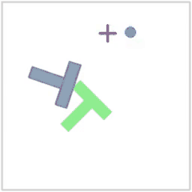

# Imitation Learning on Push-T

Teaching a robot to push a T-shaped block into a goal zone by imitating 206 human demonstrations.

<p align="center">
  
</p>

The policy sees a 5-number state (agent position, block position and angle) and predicts the next **8 actions at once** instead of one at a time. This is called action chunking, and it is the idea behind modern robot-learning methods such as [Diffusion Policy](https://diffusion-policy.cs.columbia.edu/).

This is Homework 1 of UC Berkeley's [CS 185/285 Deep Reinforcement Learning](https://rail.eecs.berkeley.edu/deeprlcourse/) (Spring 2026).

## Results

| | |
|---|---|
| Final evaluation reward | **0.629** (target: 0.5) |
| Best checkpoint | 0.673 at step 70,000 |
| Training time | ~7 minutes on 8 CPU cores |

Reward is the average over 100 test episodes of how much of the goal the block covers (1.0 = perfect).


The loss keeps falling, but reward levels off around 0.63–0.67 after 50k steps. A likely reason: when a human could push the block in two different ways, an MSE model predicts their average, which is often neither. The next part of the assignment, a flow-matching policy, is designed to handle that.

More detail: [report (PDF)](hw1/report/mse_report.pdf) · [successful rollout videos](hw1/report/videos/)

## How it works

- **Model:** an MLP with 3 hidden layers of 256 units and ReLU, about 137k parameters. It maps the state to an 8 × 2 chunk of target positions.
- **Loss:** mean squared error between the predicted chunk and the human's chunk.
- **Training:** Adam (learning rate 3e-4), batch size 128, 400 epochs, `torch.compile` for speed.
- **Evaluation:** every 10k steps the policy plays 100 episodes in the simulator, running each 8-action chunk open-loop before re-planning.

My code is in [`model.py`](hw1/src/hw1_imitation/model.py) (`MSEPolicy`), [`train.py`](hw1/src/hw1_imitation/train.py) (training loop) and [`plot_curves.py`](hw1/plot_curves.py). The data loading, environment and evaluation code is the course's starter code.

## Reproduce it

You need Linux or macOS and [uv](https://docs.astral.sh/uv/). The dataset (31 MB) downloads automatically on the first run.

```bash
git clone https://github.com/Shakthi-Bala/imitation_learning_agent.git
cd imitation_learning_agent/hw1

uv sync                    # install dependencies
uv run wandb login         # optional: log runs to Weights & Biases

uv run src/hw1_imitation/train.py --policy-type mse
```

No W&B account? Prefix the training command with `WANDB_MODE=offline` and everything is still saved locally.

Each run writes to `hw1/exp/<run_name>/`. To plot its curves:

```bash
uv run --with matplotlib plot_curves.py exp/<run_name>
```

All defaults (seed 42) match the results above. Run `uv run src/hw1_imitation/train.py --help` to see every option.

## Status

- [x] MSE action-chunking policy
- [ ] Flow-matching policy
