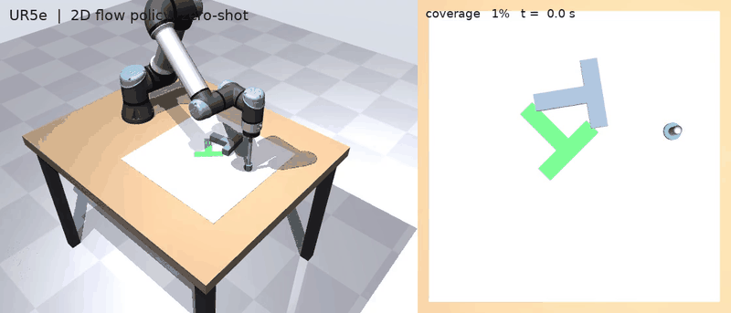
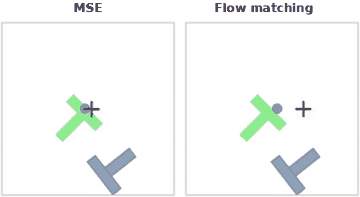
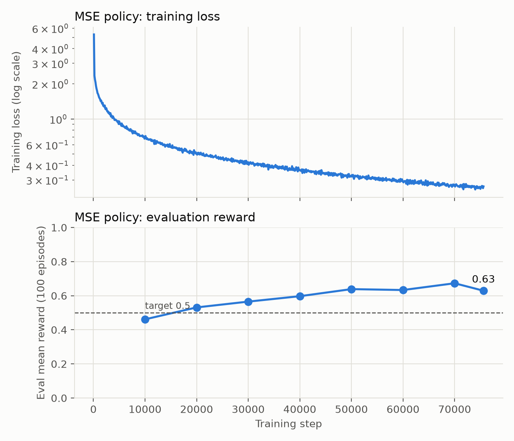
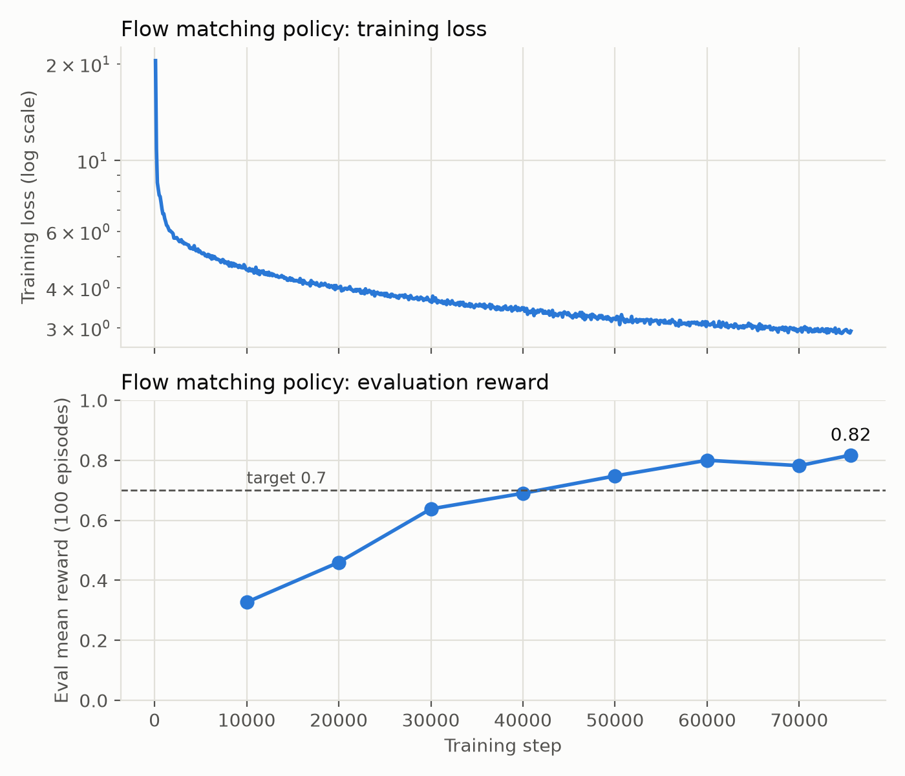
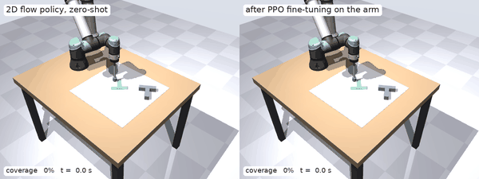

# Imitation Learning on Push-T: from 2D to a UR5e Arm

Teaching a robot to push a T-shaped block into a goal zone by imitating 206 human demonstrations, first in the 2D Push-T benchmark and then with a simulated UR5e arm.

<p align="center">
  
</p>
<p align="center"><sub>A policy trained only on 2D data, running zero-shot on a UR5e in MuJoCo. Right: top view with the arm hidden; the red dot is the policy's current target.</sub></p>

The policy sees a 5-number state (pusher position, block position and angle) and predicts the next **8 actions at once** instead of one at a time. This is called action chunking, and it is the idea behind modern robot-learning methods such as [Diffusion Policy](https://diffusion-policy.cs.columbia.edu/).

| Part | What | Folder |
|---|---|---|
| 1 | MSE and flow matching policies on 2D Push-T (UC Berkeley [CS 185/285](https://rail.eecs.berkeley.edu/deeprlcourse/) Homework 1, Spring 2026) | [`pusht_action_chunking/`](pusht_action_chunking/) |
| 2 | The same task with a UR5e arm in MuJoCo: zero-shot transfer and self-improvement | [`ur_pusht/`](ur_pusht/) |

## Part 1: 2D Push-T

I trained two policies with the same network and training budget:

- **MSE:** predicts the 8 actions directly in one pass.
- **Flow matching:** starts from random noise and refines it into an action chunk over 10 small steps, like a simpler form of diffusion.

| | MSE | Flow matching |
|---|---|---|
| Final evaluation reward | 0.629 (target 0.5) | **0.817** (target 0.7) |
| Episodes fully solved, out of 100 | 7 | **17** |
| Clear failures (reward < 0.3), out of 100 | 22 | **8** |
| Training time | ~7 min, 8 CPU cores | ~17 min, 4 CPU cores |

Reward is the average over 100 test episodes of how much of the goal the block covers (1.0 = perfect).

<p align="center">
  
</p>

MSE levels off around 0.63. When the demonstrations show two different ways to push the block, MSE predicts their average, which is often neither. In the GIF above it parks beside the T and never moves again. Flow matching samples one of the options instead, so it keeps trying and recovers. The cost is that it sometimes hesitates between strategies and rarely holds perfectly still at the goal.

<p align="center">
  
  
</p>

Reports: [MSE (PDF)](pusht_action_chunking/report/mse_report.pdf) · [Flow matching (PDF)](pusht_action_chunking/report/flow_report.pdf) · [rollout videos](pusht_action_chunking/report/videos/)

**How it works**

- **Model:** an MLP with 3 hidden layers of 256 units and ReLU, about 140k parameters, for both policies.
- **MSE loss:** squared error between the predicted chunk and the human's chunk.
- **Flow matching loss:** mix the human's chunk with noise at a random level τ, and train the network to predict the direction from the noise to the chunk. At test time, start from noise and take 10 Euler steps along that direction.
- **Training:** Adam (learning rate 3e-4), batch size 128, 400 epochs, `torch.compile` for speed.
- **Evaluation:** every 10k steps the policy plays 100 episodes in the simulator, running each 8-action chunk open-loop before re-planning.

My code is in [`model.py`](pusht_action_chunking/src/hw1_imitation/model.py) (`MSEPolicy`, `FlowMatchingPolicy`), [`train.py`](pusht_action_chunking/src/hw1_imitation/train.py) (training loop) and [`plot_curves.py`](pusht_action_chunking/plot_curves.py). The data loading, environment and evaluation code is the course's starter code.

## Push-T on a UR5e arm

The same task with a UR5e holding a stick, in MuJoCo. The T now drags on the table with real friction (μ = 0.35), which the 2D benchmark does not have. Everything else matches the 2D task (1 px = 1 mm, same start states, same success test), so the 2D policies run on the arm unchanged.

**The arm follows the policy closely.** Damped least-squares inverse kinematics, gravity compensation and a velocity feed-forward term keep the stick tip within 0.3 mm on average of where the policy sends it.

**The 2D flow policy transfers zero-shot.**

| Policy (trained in 2D) | 2D Push-T | UR5e, mean reward | UR5e, solved |
|---|---|---|---|
| MSE | 0.629 | 0.524 | 7 % |
| Flow matching | 0.817 | **0.79–0.82** | **12–20 %** |

The range is four evaluations of the same policy; tiny numerical differences between CPU types change contact-rich rollouts, so differences of about ±0.02 reward are noise.

**Retraining on the robot's own successes did not help.** Each round ran the policy on 2000 new start states, kept the solved episodes, and trained on them. I tried three variants against a control trained on the human demos alone:

<p align="center">
  
</p>

Retraining from scratch (A, B) lost 0.04–0.12 reward against the control, because the kept episodes come from start states the policy already solves, so each round's data gets narrower. Fine-tuning the previous policy (C) held roughly level. Keeping or dropping whole episodes tells the model nothing about which pushes mattered. RL fine-tuning uses the reward inside training instead:

**RL fine-tuning with PPO does improve it.** The flow policy builds each action chunk in 10 denoising steps. Adding a little noise to each step turns them into a stochastic policy, so PPO can make chunks that did better than a learned critic expected more likely (as in [DPPO](https://diffusion-ppo.github.io/)). After about 10,000 practice episodes on the arm:

<p align="center">
  
</p>

| Same 500 start states | Mean reward | Solved | Clear failures (reward < 0.3) |
|---|---|---|---|
| 2D flow policy, zero-shot | 0.797 | 14.8 % | 11.4 % |
| After PPO fine-tuning | **0.854** | 16.0 % | **6.4 %** |

Compared seed by seed, mean reward rose by 0.056 (95 % CI 0.032 to 0.082) and clear failures fell by 5.0 points (2.4 to 7.6), rescuing 26 starts the 2D policy failed outright while losing 8. The solve rate did not change measurably: RL mostly fixes failures rather than perfecting near-misses. The key setting was PPO's clip range: with the small per-step noise, the clip of 0.01 I started with blocked 40–60 % of updates and the policy never moved, while 0.1 let it learn. Advantage-weighted regression made the policy worse.

<p align="center">
  
</p>

Report: [UR5e Push-T (PDF)](ur_pusht/report/ur_pusht_report.pdf) · videos: [solved](ur_pusht/media/pusht2d_flow_seed36.mp4), [failed](ur_pusht/media/pusht2d_flow_seed12.mp4), [before vs. after RL](ur_pusht/media/zero_shot_vs_ppo_seed105.mp4) · code and setup: [`ur_pusht/`](ur_pusht/)

## Reproduce it

You need Linux or macOS and [uv](https://docs.astral.sh/uv/). The dataset (31 MB) downloads automatically on the first run.

```bash
git clone https://github.com/Shakthi-Bala/imitation_learning_agent.git
cd imitation_learning_agent/pusht_action_chunking

uv sync                    # install dependencies
uv run wandb login         # optional: log runs to Weights & Biases

uv run src/hw1_imitation/train.py --policy-type mse
uv run src/hw1_imitation/train.py --policy-type flow
```

No W&B account? Prefix the training command with `WANDB_MODE=offline` and everything is still saved locally.

Each run writes to `pusht_action_chunking/exp/<run_name>/`. To plot its curves:

```bash
uv run --with matplotlib plot_curves.py exp/<run_name> --title "Flow matching policy" --target 0.7
```

All defaults (seed 42) match the results above. Flow matching samples random noise, so its exact reward varies slightly from run to run. Run `uv run src/hw1_imitation/train.py --help` to see every option.

For the UR5e part, see [`ur_pusht/README.md`](ur_pusht/README.md).

## Status

- [x] MSE action-chunking policy
- [x] Flow matching policy
- [x] UR5e Push-T in MuJoCo: zero-shot transfer and self-improvement
- [x] RL fine-tuning of the flow policy on the arm (PPO)
- [ ] Raise the solve rate, not just the mean reward (e.g. a reward that favours the last 5 % of coverage)
