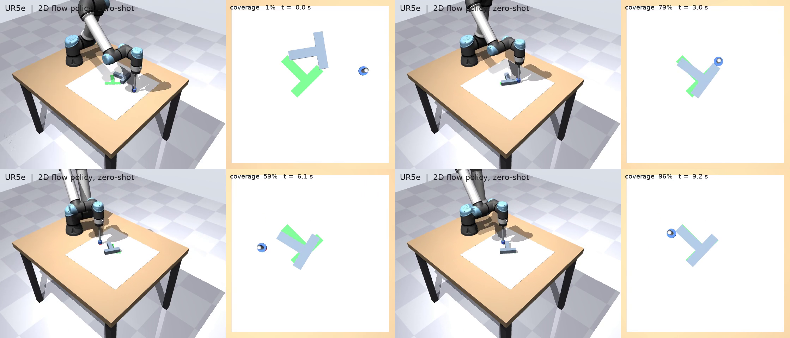
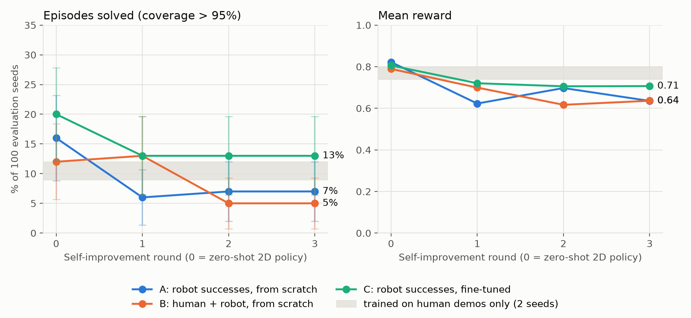
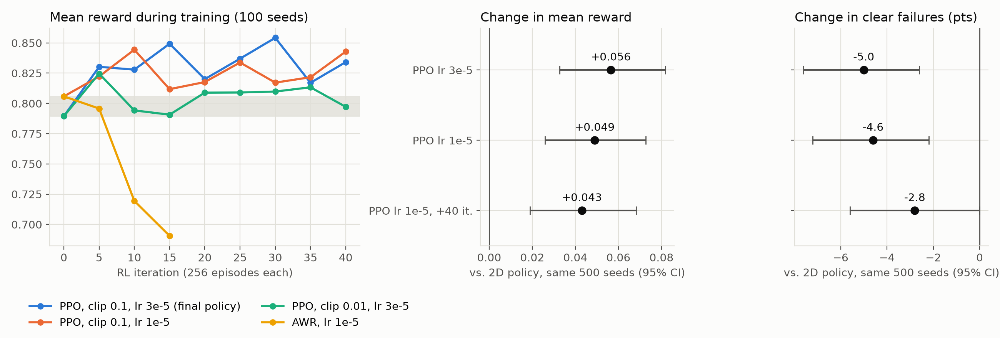
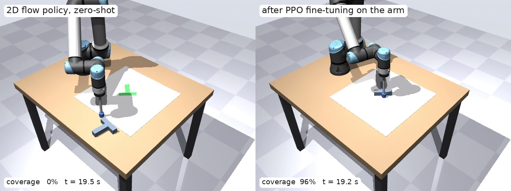

## Summary

A flow matching policy trained on the 2D Push-T benchmark pushes the T into place with a simulated UR5e arm **without any robot training data**: 0.79–0.82 mean reward on 100 evaluation seeds, the same as in its own 2D simulator (0.817), even though the robot's table has realistic friction and the 2D world has none. Self-improvement by filtered behavior cloning, which retrains on the robot's own successful episodes, did **not** improve on it. Three variants settled at 0.64–0.71 mean reward, below a control trained on the human demonstrations alone (0.74–0.80). **RL fine-tuning with PPO did improve it**: on the same 500 start states, mean reward rose from 0.797 to 0.854 (+0.056, 95 % CI +0.032 to +0.082) and clear failures fell from 11.4 % to 6.4 %, while the share of fully solved episodes did not change measurably.

## Setup

{width=100%}

**Scene.** A UR5e from MuJoCo Menagerie stands on a table and holds a 19 cm stick with a 15 mm-radius tip. The T block (120 mm bar, 90 mm stem, 30 mm thick, 234 g) slides on the table with Coulomb friction μ = 0.35. The 2D benchmark's 512 × 512 px workspace is mapped onto the table at 1 px = 1 mm, so the state (tip x, y and block x, y, angle in pixels), the action (a target tip position in pixels), the random start states per seed, and the success test (more than 95 % of the goal covered) are all identical to the 2D task.

**Controller.** The policy runs at 10 Hz and outputs 8-step action chunks, executed open-loop. Each target drives a reference point with the 2D agent's PD dynamics (k_p = 100, k_v = 20) at 100 Hz. Damped least-squares inverse kinematics turns the reference into joint targets with the stick held vertical at a fixed tip height, inside the joint limits. Gravity compensation and a velocity feed-forward term cancel the position servos' sag and lag.

| Check | Result |
|----------------------------------------|----------------------------------|
| Tip tracking on 5 human demo episodes (738 steps) | 0.28 px mean, 1.34 px max error |
| Tip height while pushing | 20.0 ± 0.1 mm |
| Slide after a 0.3 m/s push | 13.0 mm (Coulomb prediction 13.1 mm) |
| Simulation speed | 6 ms per 0.1 s control step on one CPU core |
| T at the goal pose | coverage 1.000 |

## Zero-shot transfer

Both 2D policies from the course assignment ran unchanged on the arm, on the same 100 evaluation seeds as in 2D.

| Policy (trained in 2D) | 2D Push-T | UR5e, mean reward | UR5e, solved | UR5e, reward < 0.3 |
|---|---|---|---|---|
| MSE | 0.629 | 0.524 | 7 % | 38 % |
| Flow matching | 0.817 | **0.79–0.82** | **12–20 %** | 10–11 % |

The flow policy's range covers four evaluations of the same checkpoint. The rollouts are seeded, but the evaluations ran on different CPU types, and tiny floating-point differences grow during contact. That spread, about ±0.02 mean reward and ±4 points of solved episodes, sets the resolution of every comparison below.

A likely reason the flow policy transfers despite the change in physics is that it re-plans every 8 steps from the observed block pose: when the T stops sliding sooner than it would in 2D, the next chunk simply pushes again. MSE probably loses more because its averaged chunks already stall against the block in 2D, and friction removes the coasting that sometimes rescued them.

## Self-improvement

Each round runs the current policy on 2000 fresh seeds (≥ 10,000, never used for evaluation), keeps only the solved episodes, and trains on every success collected so far. Round 0 is the 2D flow policy.

- **A, robot successes, from scratch:** a new policy is trained for 60k steps on robot successes only.
- **B, human + robot, from scratch:** the same, plus the 206 human demonstrations in every round.
- **C, robot successes, fine-tuned:** the previous round's policy is trained 20k more steps at learning rate 1e-4, keeping its normalizer.

A control trains on the human demonstrations alone with the same code for 75.6k steps (2 seeds). It separates the effect of the robot data from the difference between one training run and another.

{width=100%}

| | Round 1 | Round 2 | Round 3 | Episodes kept per round |
|---|---|---|---|---|
| A: robot successes, from scratch | 0.623 · 6 % | 0.697 · 7 % | 0.635 · 7 % | 290 · 149 · 128 |
| B: human + robot, from scratch | 0.699 · 13 % | 0.617 · 5 % | 0.636 · 5 % | 288 · 135 · 93 |
| C: robot successes, fine-tuned | 0.720 · 13 % | 0.706 · 13 % | 0.707 · 13 % | 256 · 229 · 235 |
| Control: human demos only | 0.798 · 12 % (seed 0) | 0.740 · 9 % (seed 1) | | |

Cells are mean reward · % of the 100 evaluation seeds solved.

**No variant beat the control on mean reward.** Every round of A and B is 0.04–0.12 below the control's lower end (0.740), beyond the ±0.02 evaluation noise. C is 0.02–0.03 below it, which is about the size of the noise, so fine-tuning roughly held its ground without improving. Solve rates differ by less than their confidence intervals, so the data cannot say whether the robot successes changed how often episodes finish.

**Why retraining on robot successes hurt.** The kept episodes come from the start states the current policy already solves, so each round's dataset is narrower than the last, and the from-scratch variants lose behaviour for the hard starts. As those policies weaken, they keep fewer episodes (A: 290 → 128, B: 288 → 93), which narrows the data further. Fine-tuning (C) avoids that spiral: it starts from a policy that still covers the hard starts and keeps about 230–255 episodes per round. It still does not climb, because a solved episode only says "this whole trajectory worked" and never which of its pushes mattered.

**What this points to.** The reward has to enter training itself, not only decide which episodes to keep. The next section does that.

## RL fine-tuning

**Method.** Each policy query is one decision: the state at the start of a chunk and the 8-action chunk it produces. Its reward is the gain in Push-T reward over the chunk, plus 1 if the episode is solved, so an episode's return is its final coverage reward minus the starting one, plus the bonus. A critic (MLP, 2 × 256, tanh) is trained on generalized advantage estimates (γ = 0.99, λ = 0.95) and gets 2 warm-up iterations before the policy is updated.

- **PPO over the denoising steps (DPPO-style).** Sampling adds Gaussian noise of scale σ to each of the 10 Euler steps, so each step is a Gaussian policy with a computable log-probability. The chunk's advantage is shared by its 10 steps, and each step's likelihood ratio is clipped. Evaluation uses the original deterministic sampler.
- **Advantage-weighted regression (AWR).** The flow matching loss of each executed chunk is weighted by exp(advantage / β), capped at 20.

Every run starts from the 2D flow policy and does 40 iterations of 256 episodes (10,240 episodes) on training seeds that never overlap the evaluation seeds.

| Run | Clip | Actor lr | Outcome on 100 evaluation seeds |
|---|---|---|---|
| PPO, σ = 0.05 | 0.01 | 3e-5 | flat; 55–60 % of steps clipped |
| PPO, σ = 0.10 | 0.01 | 3e-5 | flat; about 40 % of steps clipped |
| PPO, σ = 0.10 | 0.1 | 1e-5 | improved; about 3 % clipped |
| **PPO, σ = 0.10** | **0.1** | **3e-5** | **improved; about 8 % clipped** |
| PPO, σ = 0.10, 40 more iterations from the 1e-5 run | 0.1 | 1e-5 | no further gain |
| AWR, β = 0.5 | – | 1e-4 | degraded to 0.63 by iteration 10, stopped |
| AWR, β = 1.0 | – | 1e-5 | degraded to 0.69 by iteration 15, stopped |

**The clip range decided it.** With small per-step noise, a step's log-probability is very sensitive to the weights: it scales with 1/σ². A clip of 0.01 then cuts off 40–60 % of the denoising steps from the gradient, and those runs never left the evaluation noise. A clip of 0.1 lets updates through.

**Evaluation.** Because 100-seed evaluations swing by about ±0.03 reward, the final checkpoints of the improving runs and the starting policy were re-evaluated on the same 500 seeds (0–499), in one job on one node. Only final checkpoints were compared, to avoid picking the best intermediate checkpoint by its noise. Confidence intervals come from a paired bootstrap over seeds.

| Policy, same 500 seeds | Mean reward | Solved | Clear failures | Change in reward | Change in failures |
|---|---|---|---|---|---|
| 2D flow policy, zero-shot | 0.797 | 14.8 % | 11.4 % | | |
| PPO, lr 1e-5 | 0.846 | 18.2 % | 6.8 % | +0.049 (+0.026, +0.073) | −4.6 (−7.2, −2.0) |
| **PPO, lr 3e-5** | **0.854** | 16.0 % | **6.4 %** | **+0.056 (+0.032, +0.082)** | **−5.0 (−7.6, −2.4)** |
| PPO, lr 1e-5, +40 iterations | 0.840 | 16.0 % | 8.6 % | +0.043 (+0.019, +0.067) | −2.8 (−5.6, −0.2) |

{width=100%}

{width=100%}

All three PPO policies raise mean reward and lower clear failures, with intervals that exclude zero. The best one rescues 26 start states the 2D policy failed outright (reward below 0.3, now at least 0.8) and loses 8. None changes the solve rate measurably: the gain comes from fewer failures, not from finishing the near-misses. A likely reason: crossing 95 % coverage takes precise final pushes that the exploration noise disturbs, and the reward gives little extra for the last few percent. A reward that weights the final coverage more heavily is the obvious next step. The AWR runs degraded like the from-scratch self-improvement variants: weighting the policy's own fresh samples still narrows its data.

## Engineering notes

- Training crashed on Intel 6767P and AMD EPYC 9654 nodes (glibc heap-corruption assertion) inside a `torch.compile` kernel, but not on the EPYC 7543 node where the kernel cache had been built. The cache lived on shared storage, and a per-host cache directory did not fix it because the cluster's temporary directory is also shared. Robot training therefore runs in eager mode, which is fast enough for a 3 × 256 MLP.
- Headless rendering on the cluster needs the OSMesa software renderer: neither EGL on the CPU nodes nor the GPU nodes' driver offers the device platform MuJoCo requires. Mesa 25 and later no longer ship OSMesa, so the setup pins `mesalib=24.3` and preloads it so its C++ runtime wins over the system's.

## Reproduce

Commands are in [`ur_pusht/README.md`](../README.md). Raw per-round metrics are in `ur_pusht/results/`. Each self-improvement variant takes 7–16 minutes on one 32-core CPU node and each control run 3–4 minutes, so all five run in parallel in about a quarter of an hour. Each RL run takes 6–12 minutes on one 32-core node.
